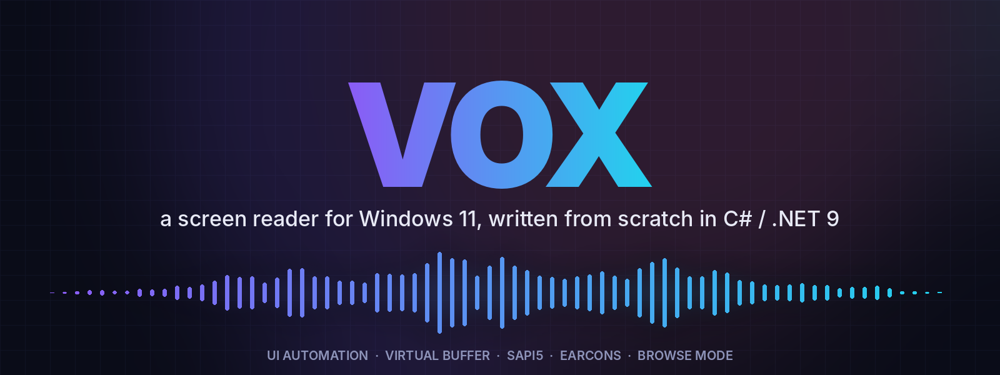
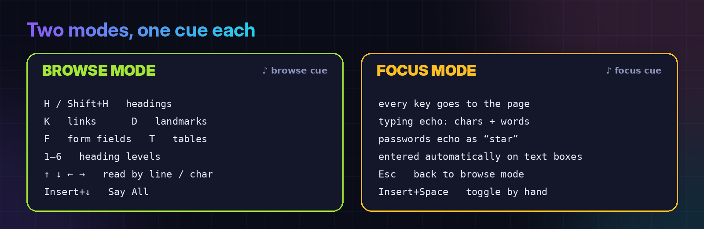
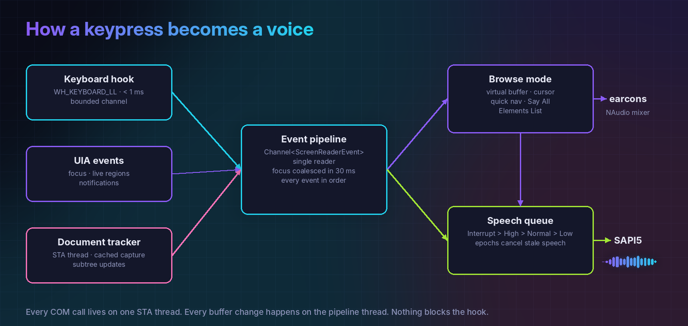

<p align="center">
  
</p>

# Vox: a free, open-source screen reader for Windows 11

Vox reads Windows aloud and lets you use your computer with the keyboard alone. It reads web
pages, documents, email and applications in speech and braille. It follows the keyboard
conventions of NVDA, so if you already use a screen reader your habits carry over.

Vox is new and still in testing. Please keep the screen reader you use now installed, so you
always have a way back. We'd love to hear how Vox works for you: see
[Feedback and bug reports](#feedback-and-bug-reports).

## Contents

- [Install Vox](#install-vox)
- [First steps](#first-steps)
- [Essential keys](#essential-keys)
- [What Vox can do](#what-vox-can-do)
- [Documentation](#documentation)
- [Feedback and bug reports](#feedback-and-bug-reports)
- [Code signing policy](#code-signing-policy)
- [For developers](#for-developers)

## Install Vox

You need Windows 11 (64-bit). Nothing else has to be installed first. The installer works with
Narrator (press **Ctrl+Windows+Enter** to turn it on), NVDA or JAWS.

1. Download `Vox-<version>.msi` from the
   [releases page](https://github.com/ChrisBrooksbank/Vox/releases). It's under the **Assets**
   heading of the newest release.
2. Open it. Check **I accept the terms in the License Agreement**, choose **Install**, and answer
   **Yes** (**Alt+Y**) when Windows asks for permission.
3. On the last page, leave **Start Vox now** checked and press **Enter** on **Finish**.
4. Vox starts talking. Turn off your other screen reader (for Narrator, **Ctrl+Windows+Enter**
   again).

After that, **Ctrl+Alt+V** starts Vox from anywhere.

**[Installing Vox](docs/install.md)** goes through every step with the exact keys to press. It also
covers security warnings for unsigned builds, the portable copy (for computers where you can't
install programs), updating, and uninstalling. If the releases page has no files yet, no build has
been published so far. The guide explains how to build Vox from source.

## First steps

The first time Vox starts, a short spoken wizard asks how fast to speak, how much detail you want,
and which key to use as the **Vox key**: **Insert** or **Caps Lock**. In this README and in the
guide, "Insert" means whichever you chose. To use the key's normal function, press it twice
quickly. The wizard ends by offering practice lessons for web pages, editing text and reviewing the
screen.

Three ways to learn the keys:

- **Input help**, **Insert+1**: while it's on, each key you press says what it does instead of
  doing it. Press **Insert+1** again to turn it off.
- **The Vox menu**, **Insert+N**: settings, the user guide, command search, practice lessons, the
  speech viewer and more. It's also on the Vox icon in the notification area.
- **The user guide and keyboard reference**: in the Vox menu, under User guide. The keyboard
  reference lists every command with its keys.

For laptops without a numeric keypad, choose the laptop keyboard layout: open the settings with
**Insert+Ctrl+G** and go to the Keyboard page.

## Essential keys

These are the desktop layout's keys. The laptop layout changes only the keys that use the numeric
keypad.

### Anywhere

| Key | What it does |
| --- | --- |
| Ctrl | Stop speech |
| Insert+Down Arrow | Say All: read from here to the end |
| Insert+Up Arrow | Read the current line |
| Insert+Tab | Say what has focus |
| Insert+T | Say the window title |
| Insert+B | Read the whole window |
| Insert+F12 | Say the time |
| Insert+N | Open the Vox menu |
| Insert+Ctrl+G | Open the settings |
| Insert+1 | Input help on or off |
| Insert+S | Pause speech, or start it again |
| Insert+Shift+S | Sleep mode: Vox stays quiet in this application |
| Insert+R | Read text in a picture or an inaccessible control (text recognition) |
| Insert+Ctrl+S | Run the welcome wizard again |
| Insert+Q, twice | Quit Vox |

### On web pages (browse mode)

In Edge, Chrome and Firefox, Vox reads a page as a document you move through with the arrow keys.
Single letters jump between elements. Add **Shift** to any letter to go backwards.

| Key | What it does |
| --- | --- |
| Up and Down Arrow | Previous or next line |
| Ctrl+Up and Ctrl+Down Arrow | Previous or next paragraph |
| Ctrl+Home, Ctrl+End | Top or bottom of the page |
| H, or 1 to 6 | Next heading, or next heading at that level |
| K | Next link |
| D | Next landmark (main content, navigation, and so on) |
| F | Next form field |
| B, E, C, X, R | Next button, edit box, combo box, check box, radio button |
| T | Next table. In a table, Ctrl+Alt+arrows move between cells |
| L, I | Next list, next list item |
| G | Next graphic |
| N | Skip past a block of links to the next text |
| Enter or Space | Activate the link, button or control at the cursor |
| Insert+F7 | Elements List: every heading, link, landmark and form field |
| Insert+Ctrl+F | Find text on the page |
| Insert+Space | Switch between browse mode and focus mode |
| Escape | Leave focus mode |

<p align="center">
  
</p>

When you Tab or arrow into a text box, Vox switches to **focus mode** by itself and plays a short
sound: now your keys go to the page, so you can type. Escape takes you back to browse mode.

## What Vox can do

**Web pages.** Browse mode for Edge, Chrome and Firefox, including Electron and WebView2 apps.
There are single-key jumps for more than 20 kinds of element, the Elements List, find, and text
selection and copy. Tables are read with their headers. Live regions and notifications are spoken
without flooding you. Pages that change while you read keep your place. Each page remembers where
you were. Vox announces cookie banners and dialogs, and Insert+Shift+D dismisses them. Math is
spoken with the optional MathCAT component. PDFs open in Edge or Chrome are read like web pages.

**Applications and documents.** Vox reads text fields and editors with caret, selection and
spelling-error reporting. It reads terminals, menus, dialogs and File Explorer's details view.
Object navigation and a review cursor let you explore any window. Mouse tracking says what is under
the pointer. Vox has special support for Word, Excel, Outlook, PowerPoint, Teams, Zoom, Visual
Studio Code, Visual Studio and Acrobat.

**Speech.** Vox speaks through the Windows OneCore voices, SAPI 5 voices, or the optional eSpeak NG.
You can change the rate, pitch, volume, punctuation level and the way capitals and numbers are
read. Text in other languages switches voice automatically. You can add your own pronunciation
dictionaries. Optional sounds play for states, modes and boundaries. Typing echo can say
characters, words or both.

**Braille.** Vox supports HID braille displays and every display BRLTTY supports. It shows
contracted or uncontracted braille with the optional liblouis component, and has routing keys,
panning, and typing from the braille keyboard.

**Text recognition and descriptions.** Vox reads text in pictures, scanned PDFs and inaccessible
applications with Windows' built-in text recognition, on your computer. AI descriptions of images
and screens are optional and off until you set them up. They use a local model or a cloud service,
and Vox asks before anything is sent.

**Sign-in screens and safety.** Vox reads the Windows sign-in, lock and "allow changes" (UAC)
screens. It restarts itself if it crashes, and says "not responding" instead of hanging when an
application stops responding. It never logs what you type. There is no telemetry.

**Yours to adjust.** A settings dialog, a voice settings ring (Insert+Ctrl+arrows) and your own key
bindings. Configuration profiles change settings per application or during Say All. Sleep mode
keeps Vox quiet in chosen applications. Vox can run as a portable copy from a USB stick.

**More.** Add-ons, and an add-on store that installs only signed packages. Remote access lets a
trainer control your computer and hear its speech. Vox's interface comes in English, Spanish,
French, German, Portuguese, Chinese, Japanese, Arabic and Hindi. The translations other than
English are machine-made and still need review. Organisations can set defaults and lock settings
with Group Policy.

## Documentation

All the guides are listed in the **[documentation index](docs/README.md)**. The ones most people
need:

- [Installing Vox](docs/install.md)
- The user guide, in the Vox menu (**Insert+N**, User guide). Its source is [docs/guide](docs/guide/index.html)
- [Changing your keys](docs/keymap.md) and [configuration profiles](docs/profiles.md)
- [Braille displays](docs/braille.md)
- Office and other applications: [Word](docs/apps/word.md), [Excel](docs/apps/excel.md),
  [Outlook](docs/apps/outlook.md), [PowerPoint](docs/apps/powerpoint.md),
  [Teams](docs/apps/teams.md), [File Explorer](docs/apps/explorer.md),
  [developer tools, Zoom and Acrobat](docs/apps/developer-tools.md)
- [Text recognition](docs/ocr.md) and [AI descriptions](docs/ai.md)

## Feedback and bug reports

Screen readers are personal, and the best features come from people who use one all day. Bug
reports, ideas and pull requests are all welcome.

- **Report a bug or suggest an idea:**
  [open an issue](https://github.com/ChrisBrooksbank/Vox/issues/new/choose) and pick **Screen
  reader bug report** or **Suggestion**. The form is a list of headings and plain text fields.
- **Test beta versions:** the [beta programme](docs/beta.md) explains how to join. It also shows how
  to copy exactly what Vox said into a report, which is the most useful thing you can send.
- **Security problems:** report them privately, as [docs/security.md](docs/security.md) explains,
  not as a public issue.

## Code signing policy

Free code signing provided by [SignPath.io](https://about.signpath.io/), certificate by
[SignPath Foundation](https://signpath.org/).

Only Vox's own programs and installer, built from this repository by the
[Release workflow](.github/workflows/release.yml) on GitHub's servers, are signed.

Team roles:

- Committers and reviewers: [Chris Brooksbank](https://github.com/ChrisBrooksbank)
- Approvers: [Chris Brooksbank](https://github.com/ChrisBrooksbank)

Privacy: Vox sends nothing about you anywhere unless you use a feature that needs the network,
and those are off or wait for you to start them. See the [privacy policy](docs/privacy.md).

## For developers

Vox is written in C# on .NET 9. It uses UI Automation to read Windows, and keeps a virtual buffer
model for web pages. It has a single ordered event pipeline and a priority speech queue. The core
logic sits behind interfaces and is covered by nearly 3,000 unit tests that need no screen,
voice or browser.

```powershell
git clone https://github.com/ChrisBrooksbank/Vox.git
cd Vox
dotnet build                          # build the solution
dotnet test                           # run the tests (on Windows)
dotnet run --project src/Vox.App      # run Vox from the build folder
```

You need Windows 11 and the [.NET 9 SDK](https://dotnet.microsoft.com/download/dotnet/9.0). On
Linux, `dotnet build -p:EnableWindowsTargeting=true` builds everything, but the tests and Vox itself
need Windows. CI builds and tests every push on Windows.

Before you open a pull request, `dotnet build && dotnet test` must pass. Also follow these house
rules:

- keep the keyboard hook callback under 1 ms;
- make every UI Automation call on the UIA thread;
- put key bindings in the keymap JSON, not in code;
- add a test for each behaviour you change.

These pages explain the code:

- [CLAUDE.md](CLAUDE.md): the architecture in depth (event flow, threading, every subsystem).
- [docs/README.md](docs/README.md#for-developers-and-maintainers): building the installer,
  signing, updates, add-ons, end-to-end tests, benchmarks, translating, and the security
  checklist.
- [PLAN.md](PLAN.md), [COMMERCIAL_PARITY_PLAN.md](COMMERCIAL_PARITY_PLAN.md) and
  [IMPLEMENTATION_PLAN.md](IMPLEMENTATION_PLAN.md): the roadmap and task list. [specs/](specs/)
  holds the per-subsystem requirements.

How the event pipeline fits together:

<p align="center">
  
</p>

Vox stands in a long line of talking machines and screen readers, from the Optacon and the Kurzweil
Reading Machine to JAWS and NVDA. [A short history of computers that talk](docs/history.md) tells
that story.

---

Vox is MIT licensed. See [LICENSE](LICENSE).

> "The power of the Web is in its universality. Access by everyone regardless of disability is an
> essential aspect." (Tim Berners-Lee)
