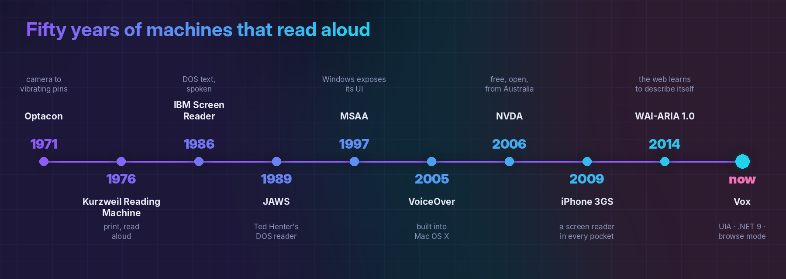

# A short history of computers that talk

  

**Before speech, there was touch.** In 1971 the **Optacon** went on sale. Stanford engineer
John Linvill designed it after his daughter Candy lost her sight. A tiny camera passed over
printed text, and a grid of vibrating pins raised each letter's shape under a fingertip. It
was slow and took months to learn, but for the first time ordinary print could be read
without a sighted helper.

**Then machines started reading aloud.** In 1976 Ray Kurzweil unveiled the **Kurzweil
Reading Machine**, a flatbed scanner, an omni-font OCR engine and a speech synthesizer the
size of a washing machine. It read books out loud. Stevie Wonder famously bought one of the
first.

**Then the PC arrived, and someone had to make it talk.** In 1986 IBM's **Screen Reader**
for DOS read the text-mode screen through a speech synthesizer and a dedicated keypad. It
was the work of Jim Thatcher, a mathematician who spent the rest of his career on
accessibility. In 1989 Ted Henter, a motorcycle racer blinded in a car crash, shipped
**JAWS** ("Job Access With Speech"). JAWS went on to become the dominant commercial screen
reader for decades.

**Then the GUI broke everything.** DOS screens were text in memory, so a screen reader just
read them. Windows *drew* its text as pixels, which left nothing to read. Screen readers
fought back with *off-screen models*: they intercepted every drawing call and rebuilt the
screen as text behind the scenes. It was heroic, fragile work. Microsoft answered in 1997
with **Active Accessibility (MSAA)**, so applications could *describe* themselves to
assistive tech. Its successor, **UI Automation**, arrived with Windows Vista, and Vox is
built on it.

**Then came the web, the hardest UI of all.** Pages aren't windows full of controls. They're
long documents with links, headings and forms scattered through them. Screen readers
responded with the **virtual buffer**: they copy the page into a flat document the user can
arrow through like a word processor, with single-letter keys to jump between elements. The
idea of *browse mode* and *focus mode* comes from this era, and it's still the best answer we
have.

**Then screen readers got free.** In 2005 Apple built **VoiceOver** into Mac OS X, so the
reader came with the computer rather than a large licence fee. In 2006 Michael Curran, a
blind student in Australia, started **NVDA** (NonVisual Desktop Access), a free, open-source
Windows screen reader written in Python. It's now one of the most widely used screen readers
in the world. In 2009 the **iPhone 3GS** put a screen reader into every pocket, with
gestures in place of a keyboard. And in 2014 **WAI-ARIA 1.0** became a W3C Recommendation,
which gave web developers a standard way to tell assistive tech what their widgets are and
what state they're in.

**Now there's Vox.** Same lineage, new engine: native UI Automation, a typed and tested core,
and an event pipeline designed for the web as it is today, with single-page apps, live
regions and pages that never stop changing.

[Back to the README](../README.md)
