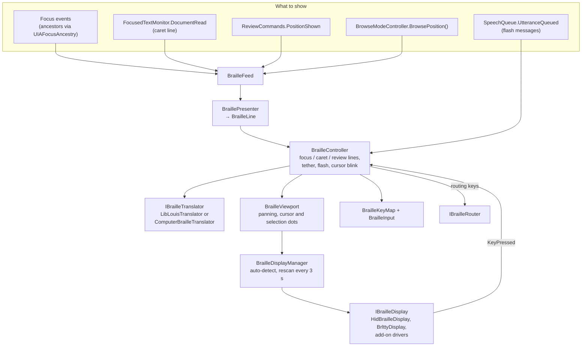
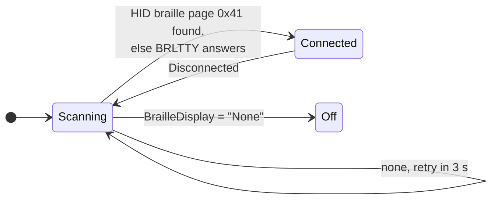

# Braille

The braille code is in `src/Vox.Core/Braille/`. `Vox.App/BrailleService`, a second hosted
service that starts after `ScreenReaderService` (and not in secure mode), wires it up. For the
user's view, see [Braille](../braille.md).

## Parts

In words: `BrailleFeed` collects what to show from focus events, the caret line, the review
cursor and the browse cursor, and `BraillePresenter` turns each into a `BrailleLine`. The
`BrailleController` keeps a focus line, a caret or browse line and a review line, shows the one
the tether picks, and briefly flashes what Vox says. Lines are translated to cells, panned and
drawn by the viewport, and written to the display found by `BrailleDisplayManager`. Display keys
come back to the controller, which runs commands, types braille input or routes the cursor.

## Cells and translation

- A cell is a byte with bit *n−1* for dot *n* (`BrailleDots`), which also converts to and from
  Unicode braille (U+2800).
- `IBrailleTranslator.Translate` returns a `BrailleTranslation`: the cells plus maps from
  characters to cells and back, used for the cursor and routing keys. It can leave the word at
  the cursor uncontracted. `BackTranslate` goes the other way, for typing.
- `LibLouisTranslator` loads the optional liblouis component from `VoxPaths.Components/liblouis`
  dynamically. Without it, `ComputerBrailleTranslator` uses NABCC.
  `BrailleTranslatorFactory` chooses.
- `BidiText` leaves invisible direction marks out, keeping the maps right; Arabic and Hebrew
  braille is shown left to right in logical order.

## Displays

Drivers implement `IBrailleDisplayDriver` (`TryConnect`, `Disconnect`, `Disconnected`) and
give an `IBrailleDisplay` (`Write(cells, cursorPosition)` and `KeyPressed`, with the driver's
key names and the routing cell).

In words: `BrailleDisplayManager` looks for a HID braille display first, then BRLTTY. While
none is connected it tries again every 3 seconds. When a display disconnects it goes back to
scanning. Setting `BrailleDisplay` to "None" turns braille off.

- `HidBrailleDisplay` (`Braille/Hid/`) speaks the HID braille usage page 0x41.
- `BrlttyDisplay` (`Braille/Brltty/`) speaks BrlAPI over TCP. See [BRLTTY](../brltty.md).
- Add-ons can add drivers (`BrailleDisplayManager.AddDriver`); add-on drivers' `TryConnect` has
  a 1 s budget.

## The controller

`BrailleController` is thread-safe (one lock) and takes an injectable `TimeProvider`, so tests
control time.

- **Tether** (`BrailleTether`, Insert+Ctrl+T): show the focus/caret line or the review line.
- **Flash messages**: text Vox speaks is shown briefly, unless a line update came within 150 ms
  (that update is the more useful thing to show).
- **Cursor**: blinked with dots 7 and 8; selection is shown with dots 7 and 8 too.
- **Keys**: `BrailleKeyMap` reads `assets/braille/keymaps/common.json` plus the driver's own
  file. Dot chords are typed through `BrailleInput`; contracted words are back-translated on
  Space or Enter and sent with `IKeyboardOutput`.
- **Routing**: `BrailleRouter` moves the caret with `ITextRange.Select`, or the browse cursor
  through a `BrailleRouteEvent` that the pipeline hands to `BrowseModeController.RouteTo`.

`BraillePresenter` adds role labels after links, buttons, fields, headings and graphics in
browse lines (`BrailleLabels`, `assets/braille/labels-en.json`).

## Testing

Tests use `FakeBrailleDisplay` and `FakeBrailleTranslator` (one cell per character, plus
whole-word contractions) from `tests/Vox.Core.Tests/TestSupport/`.
