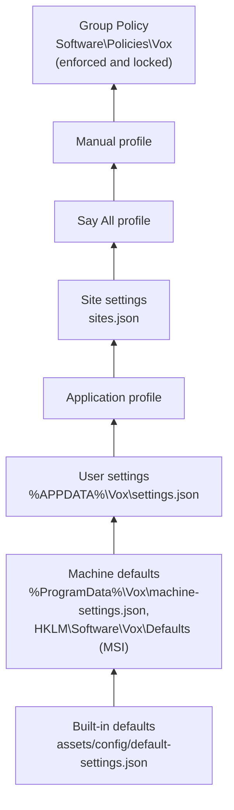
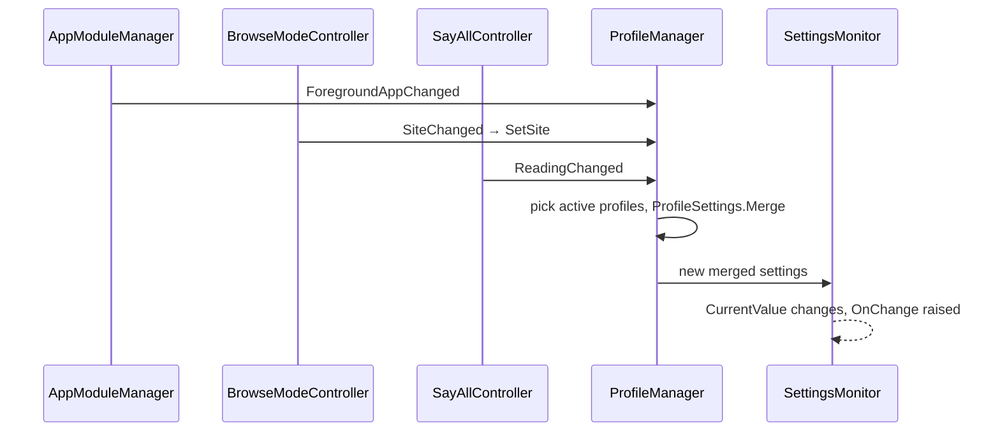
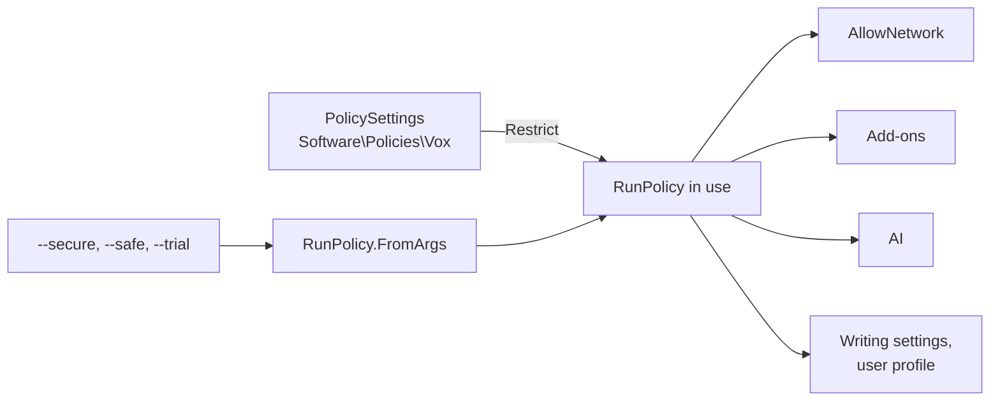
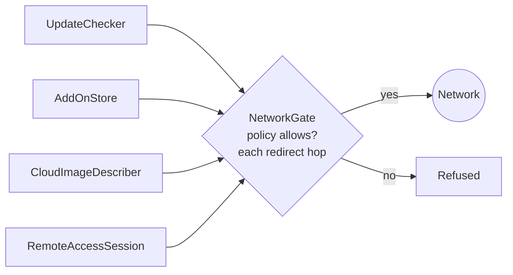

# Settings, profiles and policy

Settings are a single immutable record, `VoxSettings`, read through
`IOptionsMonitor<VoxSettings>`. Code reads `CurrentValue` at the moment it needs a value, so a
change applies at once without a restart.

## Layers

In words, lowest first: built-in defaults, then the computer's defaults (a JSON file or the
registry values the MSI writes), then the user's settings file. Profiles go on top of that, in
the order application, site, Say All and manual. Group Policy is applied last, so its enforced
settings always win and the settings dialog shows them as set by the organization.

- `SettingsManager` and `SettingsMonitor` load, merge and watch the files. `NormalValue` is the
  user file's settings; `CurrentValue` is the merged result.
- `UpdateSettings` while a profile is active records the difference in the top profile. AI
  settings (`ProfileManager.GlobalSettings`) always stay in the normal configuration.
- Saves are atomic: a temporary file, then a move. A file that fails to parse on reload leaves
  the current settings in place.
- Files carry `SchemaVersion`. An older file is migrated step by step on its JSON
  (`SettingsMigrations`) and saved, with the old file kept as `settings.v<N>.json`. A file from a
  newer Vox is read but never overwritten.

To add a setting: add the property to `VoxSettings` with its default, add it to
`default-settings.json`, read `CurrentValue` where it's used, and add a field to
`SettingsPages` if users should change it. If it should be applied when it changes,
`ScreenReaderService` re-applies changed values.

## Profiles

In words: the profile manager hears when the foreground application changes, when the browser
moves to another site and when Say All starts or stops. It works out which profiles apply,
merges them in order and hands the result to the settings monitor, whose `CurrentValue` changes.

Profiles are sparse: they hold only what differs (`ProfileStore`,
`%APPDATA%\Vox\profiles\*.json`). Site settings (`SiteSettingsStore`, `sites.json`) hold a few
browse-mode settings per site. See [configuration profiles](../profiles.md).

## Run policy

`RunPolicy` says what this instance of Vox may do. It comes from the command line, then Group
Policy restricts it.

In words: the command line sets the starting policy and Group Policy can only take things away
from it. The result decides whether Vox may use the network, add-ons, AI, and whether it may
write settings or touch the user profile.

| Mode | What it does |
| --- | --- |
| Secure (`--secure`) | Never writes settings or touches the user profile, the network, add-ons or AI. No user keymap, dictionaries or labels. No magnifier. |
| Safe (`--safe`) | Loads no add-ons. `RestartRequest` restarts into or out of it, through exit codes under the watchdog. |
| Normal | Everything, unless Group Policy turns it off (`DisableNetwork`, `DisableAddOns`, `DisableAI`, `DisableMagnifier`). |

Never log typed text or field values; `SensitiveTextLoggingTests` checks this.

## The network gate

Every network connection goes through `NetworkGate`. It refuses when the policy turns the
network off, and its HTTP client follows redirects itself, checking each hop. `MayRead` also
gates a `file:` address on another computer. The users of the network are all optional and
off or user-started: updates (signed feed), the add-on store (signed catalogue), cloud AI
(asks first) and remote access. See the [privacy policy](../privacy.md) and
[security](../security.md).

In words: the update checker, add-on store, cloud AI and remote access all connect through the
network gate, which checks the policy and every redirect before anything leaves the computer.

## Enterprise

`MachineSettings`, `PolicySettings` (with the ADMX templates in `installer/policy`) and
`RemoteSessionMonitor` (RDP and Citrix) live in `src/Vox.Core/Enterprise/`. See
[deploying Vox in an organization](../enterprise.md).
