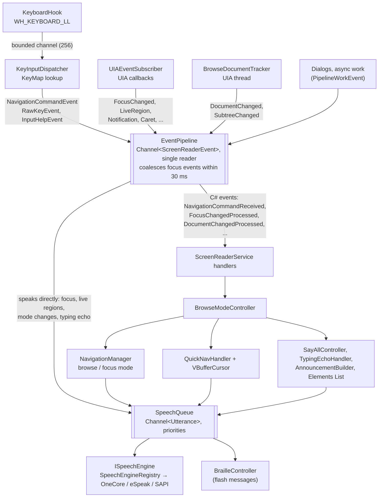
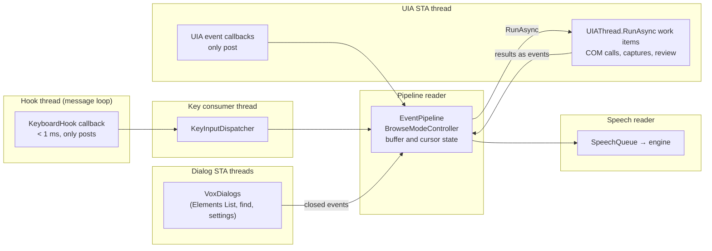
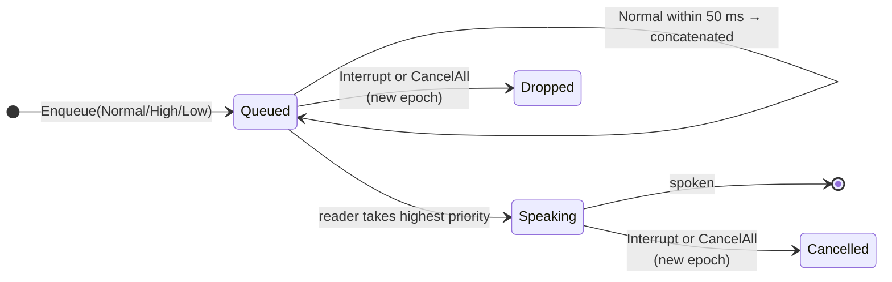

# Event pipeline and threading

Everything Vox reacts to — a key, a focus change, a page update, a dialog closing — becomes a
`ScreenReaderEvent` and goes through one ordered queue, the `EventPipeline`. One reader takes
events off it in order. That single reader is the main rule of Vox's design: the buffer, the
browse cursor and the navigation state are touched only on the pipeline thread, so they need no
locks.

## Event flow

In words: the keyboard hook posts keys to a bounded channel, where the dispatcher turns them into
commands or raw keys. Commands, UIA events and document captures all go into the event
pipeline. The pipeline speaks some events itself (focus, live regions, mode changes, typing
echo) and raises C# events for the rest. `ScreenReaderService` forwards those to
`BrowseModeController`, which drives navigation, quick navigation, Say All and the Elements
List. Everything that speaks puts utterances on the speech queue, which feeds the speech engine
and flashes the text on the braille display.

## Events

The event types are records deriving from `ScreenReaderEvent` in
`src/Vox.Core/Pipeline/ScreenReaderEvent.cs`. The main ones:

| Event | Posted by | Means |
| --- | --- | --- |
| `NavigationCommandEvent` | `KeyInputDispatcher` | A key bound to a `NavigationCommand` was pressed. |
| `RawKeyEvent` | `KeyInputDispatcher` | An unbound key (used for typing echo). |
| `InputHelpEvent` | `KeyInputDispatcher` | A key pressed while input help is on. |
| `AddOnCommandEvent` | `KeyInputDispatcher` | A key bound to an add-on command. |
| `FocusChangedEvent` | `UIAEventSubscriber` | Focus moved. Carries name, role, value, states, description. |
| `LiveRegionChangedEvent`, `NotificationEvent` | `UIAEventSubscriber` | A live region or UIA notification. |
| `CaretMovedEvent`, `TextEditedEvent` | `UIAEventSubscriber` | The caret moved or text changed in the focused field. |
| `DocumentChangedEvent` | `BrowseDocumentTracker` | A page was captured into a new buffer (maybe partial). |
| `SubtreeChangedEvent` | `BrowseDocumentTracker` | Part of the page changed and was re-captured. |
| `FocusInDocumentEvent` | `BrowseDocumentTracker` | The focused element is in the current document after all. |
| `ForegroundWindowChangedEvent` | `ForegroundWindowMonitor` | Another window came to the front. |
| `ElementsListClosedEvent`, `FindPromptClosedEvent`, `VoxDialogClosedEvent` | Vox's dialogs | A dialog on its own thread closed with a result. |
| `BrailleRouteEvent` | the braille router | A routing key was pressed over a page. |
| `PipelineWorkEvent` | anything | Run this `Action` on the pipeline thread. |

To add an event: add the record, then add a `case` for it in `EventPipeline.ProcessEventAsync`.

### Posting

Producers post through `IEventSink.Post`, which is a non-blocking `TryWrite`. They never wait for
the pipeline. That matters most for UIA callbacks, which must return at once.

### Focus coalescing

When a `FocusChangedEvent` arrives, the pipeline waits 30 ms and drains the queue, keeping only
the last focus event. Other events that arrived meanwhile are still handled, in order, after the
pending focus event. This stops a burst of focus changes (a menu opening, a page loading) from
being spoken one after another.

### Hooks for app modules and add-ons

The pipeline has delegate seams that app modules and add-on plug-ins hang off:

- `EventFilter` can drop an event (`IAppModule.ShouldProcess`).
- `FocusAnnouncementFormatter` can replace or silence focus speech.
- `FocusContextProvider` adds the window title or menu context before a focus announcement (said
  separately, it would be interrupted).
- `ErrorMessageProvider` and `CustomLabelProvider` add a field's error message and a custom
  label.
- `EventProcessed` sees every handled event.

## Threads

In words: the hook callback only posts to a channel; a consumer thread reads it and runs the
dispatcher. UIA work runs on one STA thread, and its callbacks only post to the pipeline. The pipeline reader owns the buffer and cursor state,
asks the UIA thread for work with `RunAsync`, and gets results back as events. The speech queue
has its own reader. Vox's dialogs run on their own STA threads and report back with events.

The rules:

1. **The keyboard hook callback must take under 1 ms.** It only posts to a channel. Windows
   silently removes a slow low-level hook (`HookHealth` notices and reinstalls it, but keys are
   lost meanwhile).
2. **Every UIA call goes through `UIAThread.RunAsync`.** COM objects are apartment-threaded and
   are never shared across threads. See [UI Automation](ui-automation.md).
3. **No command handler awaits the UIA thread.** Stop speech and Quit must work while an
   application has hung UIA.
4. **Results from other threads come back as pipeline events** (`PipelineWorkEvent`,
   `DocumentChangedEvent`, `...ClosedEvent`), so buffer and cursor state change only on the
   pipeline thread. Slow reads that app modules start carry a sequence number, so a late result
   is dropped.
5. **`IncrementalUpdater` never mutates a document**; it returns a new one, so a snapshot handed
   to another thread stays valid.

## Speech queue

The speech queue is a second channel, of `Utterance`s, with its own reader. See
[Speech and audio](speech.md) for the details. In short:

In words: utterances wait in the queue; normal ones arriving within 50 ms of each other are
joined. The reader speaks the highest priority first. An `Interrupt` utterance or `CancelAll`
starts a new epoch, which cancels the utterance being spoken and drops everything queued
before it.

Priorities are `Interrupt > High > Normal > Low`. User navigation and focus changes use
`Interrupt`, user mode toggles `High`, polite live regions `Low`.
