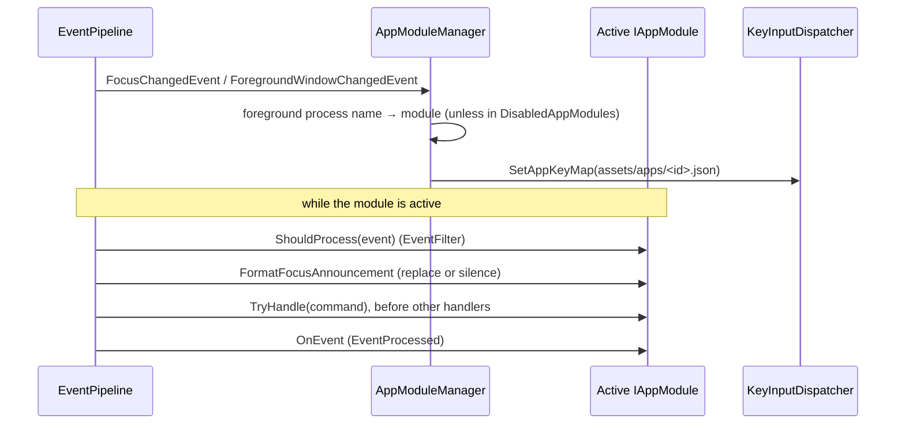
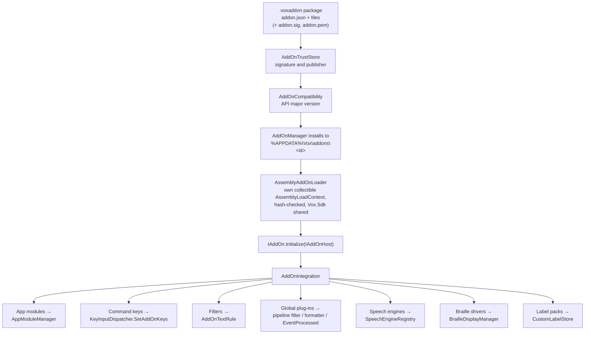
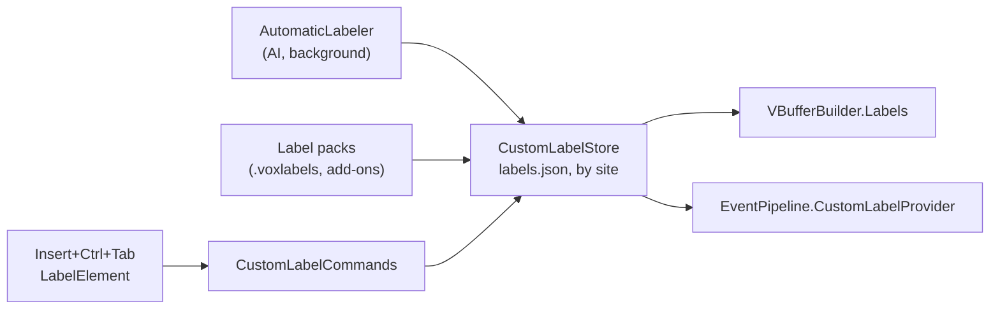
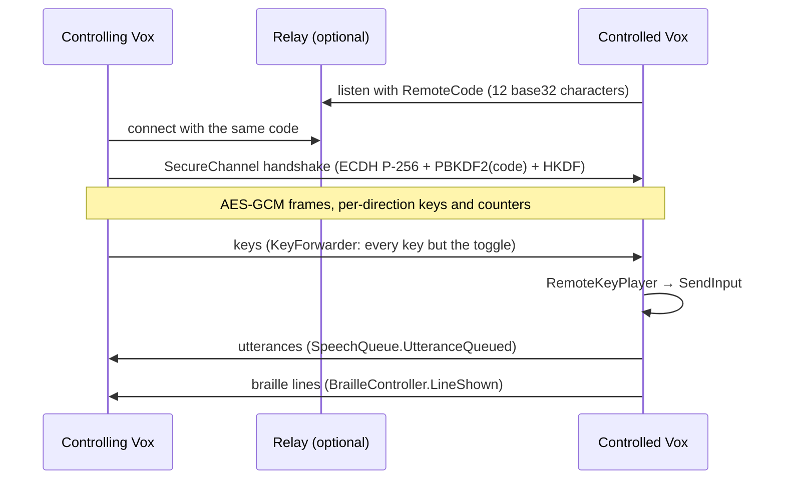

# Extensibility

Vox can be changed for one application (app modules), extended by third parties (add-ons),
taught names for unlabelled controls (custom labels), and driven from another computer (remote
access).

## App modules

An app module is support for one application. It's an `IAppModule` (usually derived from
`AppModule`) in `src/Vox.Core/AppModules/`, picked by the foreground process name. See the
user guides in [docs/apps](../apps/).

In words: on each focus change and foreground window change the manager finds the module for
the foreground process and gives its keymap to the dispatcher. While it is active the module
can drop events, rewrite or silence the focus announcement, handle commands before anything
else, and see every handled event.

- Module members run on the pipeline thread. Slow reads run off it and come back as
  `PipelineWorkEvent`s with a sequence number, so late results are dropped.
- Office is read through its object model: `IOfficeObjectModel` (`OfficeObjectModel`, late
  bound on its own STA thread, found through `OBJID_NATIVEOM` or the running object table; null
  on any failure). Tests use `FakeOfficeObjectModel`.
- Modules: Word, Excel, Outlook, PowerPoint, Explorer, Teams and Zoom (`MeetingAppModule`), and
  `QuietAppModule`s for VS Code, Visual Studio and Acrobat that drop announcements repeating
  what Vox just said.

## Add-ons

Add-ons reference only `Vox.Sdk`. The full guide, including packaging and signing, is
[Add-ons](../addons.md).

In words: a package is checked for its signature and API version, installed into the user's
add-ons folder, and loaded into its own collectible load context after its files' hashes are
checked. Its `Initialize` method registers what it offers, and `AddOnIntegration` hands each
part to the matching part of Vox: app modules, command keys, announcement filters, global
plug-ins, speech engines, braille drivers and label packs.

- Every call into an add-on goes through its `AddOnGuard`, with a time budget. Five failures in
  a minute, or not responding, turns the add-on off, and Vox says so.
- Disabling, removing, updating or turning off an add-on takes everything it added back out and
  unloads its load context.
- Add-ons never see keys, typed text or a password's value.
- `AddOnStore` reads a signed catalogue and installs only a package whose SHA-256 the catalogue
  lists.
- `--safe` starts Vox with no add-ons loaded.

## Custom labels

In words: the user labels an element with Insert+Ctrl+Tab; automatic labels from AI and label
packs are added to the same store, under the user's own labels. The store gives labels to the
buffer builder, which names labelled elements by their label, and to the pipeline, which says
them on focus.

An element is matched by an `ElementSignature`: its automation id, else its role, its
ancestors' roles and the last words before it. A change re-captures the page.

## Remote access

Two Vox computers connect so a trainer can control the other and hear its speech. See
[remote access](../remote.md).

In words: the controlled computer waits with a one-time code, directly or at a relay, and the
controlling computer connects with the same code. They agree keys with ECDH mixed with the
code, then exchange AES-GCM encrypted JSON messages. The controlling side sends every key
except the toggle; the controlled side plays them with `SendInput` and sends back what its Vox
says and shows in braille.

The relay (`Vox.App --remote-relay`) pairs the two sides by a hash of the code and only pipes
encrypted bytes. Remote access is never available on secure screens or with the network off.

## AI and text recognition

Text recognition (`Ocr/`) and AI descriptions (`Ai/`) put their results under the review cursor
as an `ITextDocument`. All AI goes through `AiAssistant` and `AiConsent`; the cloud never gets a
password field, a private app or site, or anything with the network off. See
[text recognition](../ocr.md) and [AI descriptions](../ai.md).
