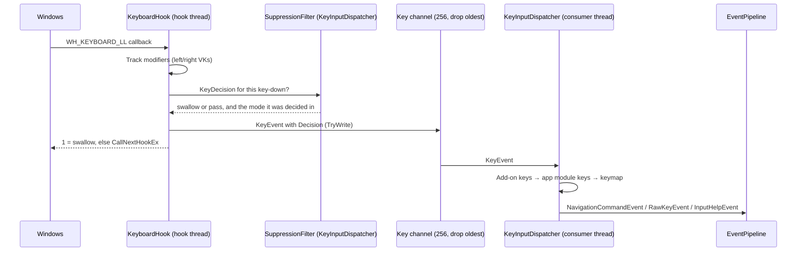
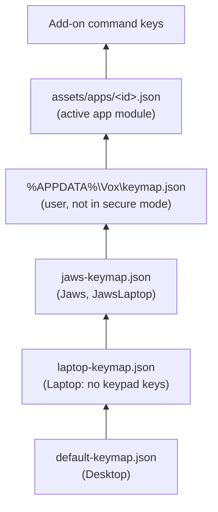
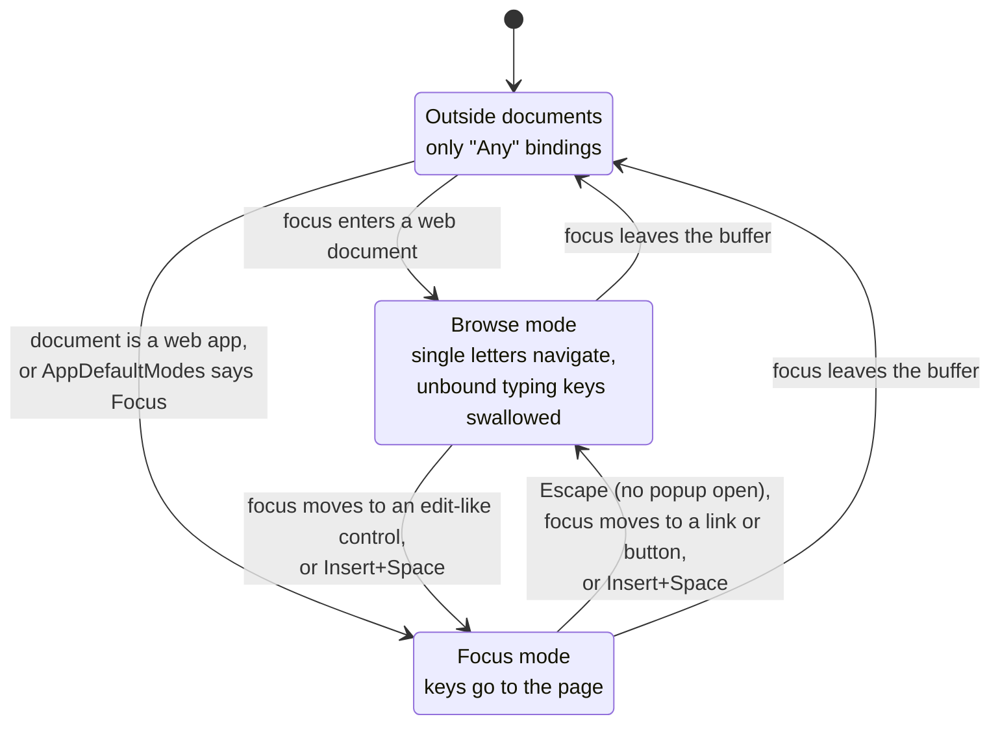

# Keyboard input

Vox sees every key through a low-level keyboard hook, decides at once whether to swallow it,
and turns the keys it keeps into commands. Key bindings live in JSON keymaps, never in code.

## From key press to command

In words: Windows calls the hook for every key. The hook updates its modifier state, asks the
dispatcher's suppression filter whether to swallow the key, posts the key with that decision to
a bounded channel, and returns to Windows within a millisecond. A consumer thread reads the
channel; the dispatcher looks the key up (add-on keys first, then the active app module's, then
the keymap) and posts a command, a raw key or an input help event to the pipeline.

The **decision travels with the key** (`KeyEvent.Decision`). The dispatcher acts on the key
exactly as it was decided at press time, even if the mode changed in between. That is why, for
example, Escape in a focus-mode field with a popup open goes to the page.

### The hook (`KeyboardHook`)

- It tracks modifiers itself, because the low-level hook reports left and right virtual keys.
  Missed key-ups are reconciled with `GetAsyncKeyState`, and the state is reset on a session
  switch.
- `HookHealth` notices when Windows has removed the hook: input arrived that the hook didn't
  see, then an injected probe key it didn't see either. The hook is then reinstalled.
- Keypad keys with Num Lock off arrive as navigation keys. `KeyEvent.IsKeypad` marks them, and
  `NumpadKeys.BindingCodes` tries them as Numpad0–9 first, then as the key they stand for.

### The Vox key

`KeyModifiers.Insert` means the screen reader modifier, Insert or Caps Lock depending on the
settings. Every key pressed with it is swallowed. The modifier itself is swallowed too, unless
it is tapped twice quickly on its own (`ModifierTapDetector`), which passes its normal function
through.

## Keymaps

In words, from bottom to top: the desktop keymap is the base. The laptop layout removes the
keypad keys and adds its own; the JAWS layouts add common JAWS keys on top of either. The
user's keymap goes over the chosen layout. At run time the active app module's keys are looked
up before the keymap, and add-on command keys before those.

- `KeyboardLayout` picks the layout, and `KeyMap.LoadLayout` builds it. A change is applied live
  with `KeyInputDispatcher.SetKeyMap`.
- In the user keymap, `"command": "None"` unbinds a key. Duplicates and commands left without a
  key are logged as conflicts. See [your own keys](../keymap.md).
- An entry binds a key in a mode: `Browse`, `Focus` or `Any`. A binding with
  `"passThrough": true` runs the command and lets the key through too.
- The keymaps are embedded in `Vox.Core` as a fallback (`KeyMap.LoadBuiltIn`).

### Commands

Every command is a value of `NavigationCommand`, and every one needs a name, description and
category in `CommandCatalog`. That catalog is the single source for input help, the input
gestures dialog, command search and the generated keyboard reference; a test enforces it. New
app-module commands go at the end of `NavigationCommand` in `CommandCategory.Applications`.

## Modes

Which bindings apply depends on where focus is and which mode Vox is in.

In words: outside web documents only "Any" bindings apply. When focus enters a web document
Vox is in browse mode, unless the document is a web application or the app is set to start in
focus mode. Moving focus to an edit-like control (or pressing Insert+Space) enters focus mode.
Escape, moving to a link or button, or Insert+Space goes back to browse mode. Leaving the
document turns the browse and focus bindings off.

Details worth knowing:

- Focus mode is entered when focus *moves* to an edit-like control, not on repeated focus
  events for the same element and not on load-time focus on a page not visited before.
- A focus event for an element not in the buffer turns browse and focus bindings off at once,
  so typing after Ctrl+L or Alt+Tab isn't swallowed. `FocusInDocumentEvent` turns them back on
  if the element is in the document after all.
- In browse mode, unbound typing keys are swallowed so they can't trigger page shortcuts.
- `DocumentModes` treats a page as a web application when an element near the root has role
  `application`, or an "editor" role description, holding at least half its text.
- Automatic mode switches play only the mode sound. User toggles are spoken too.

### Other input states

| State | Effect |
| --- | --- |
| Input help (Insert+1) | Every key but a lone modifier is swallowed; the pipeline says the key and its command. |
| Sleep mode | While a listed app has focus, speech is muted and every key passes except the toggle. |
| Vox dialog open | Browse keys are off (`BeginOwnDialog` / `EndOwnDialog`). |
| Capturing a gesture | `CaptureNextKey` swallows the next non-modifier key and hands it to the gestures dialog. |
| Remote control | `KeyForwarder` is set: every key but the toggle is swallowed and sent to the other computer. |
