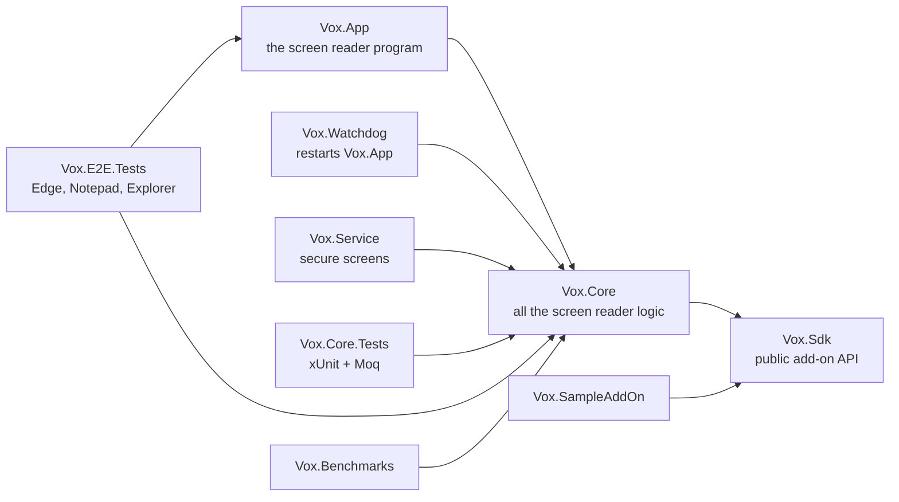
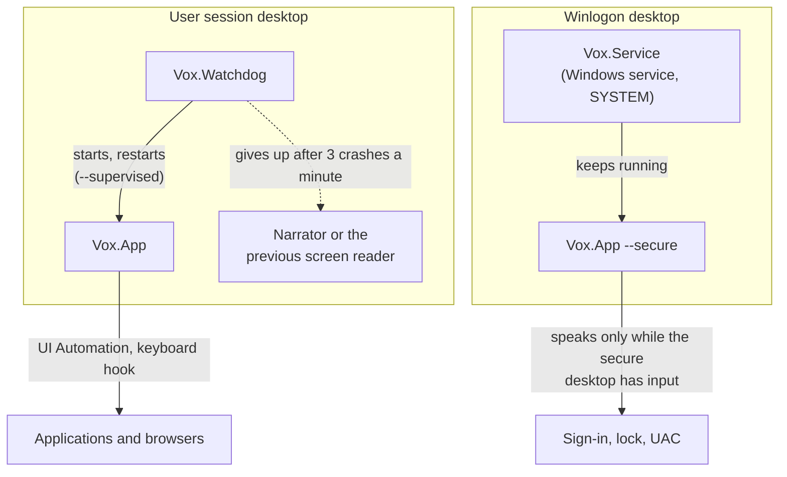
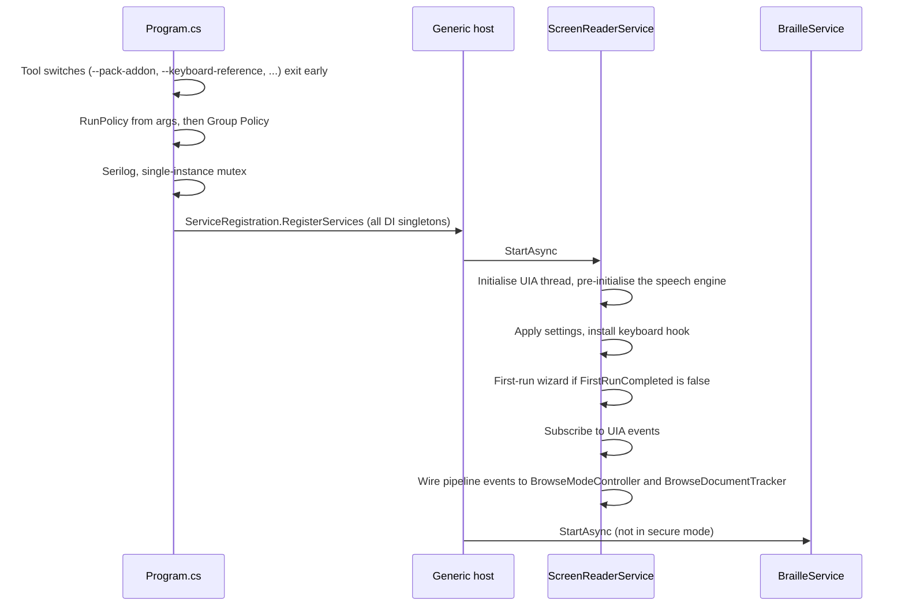

# Overview

Vox is a screen reader for Windows 11 written in C# on .NET 9
(`net9.0-windows10.0.19041.0`). It reads Windows through UI Automation (UIA), speaks through
OneCore, SAPI 5 or eSpeak NG, plays sounds through NAudio, and shows braille on HID and BRLTTY
displays. Web pages are read through a *virtual buffer*: a flat text model of the page that the
browse-mode keys move through.

## Projects

In words: `Vox.Core` references only `Vox.Sdk`. The three programs (`Vox.App`, `Vox.Watchdog`,
`Vox.Service`) and the test and benchmark projects reference `Vox.Core`. Add-ons, such as the
sample add-on, reference only `Vox.Sdk`.

| Project | What it is |
| --- | --- |
| `src/Vox.Sdk` | The public add-on API (`IAddOn`, `IAddOnHost`, `AddOnCommand`, `IAppModule`, ...). It references nothing of Vox, so add-ons don't depend on Vox's internals. See [add-ons](../addons.md). |
| `src/Vox.Core` | Everything that can be tested: input, the pipeline, UIA, the buffer, speech, braille, settings, add-ons. Nearly all code lives here. |
| `src/Vox.App` | The screen reader. `Program.cs` reads the arguments, `ServiceRegistration` builds the DI container, and `ScreenReaderService` and `BrailleService` connect the components. It is also the command-line tool for packing add-ons, signing catalogues, the remote relay and settings import. |
| `src/Vox.Watchdog` | Starts `Vox.App` and restarts it after a crash, at most 3 times a minute. Past that it says so through SAPI and starts Narrator, or the screen reader trial mode replaced (`WatchdogFallback`). |
| `src/Vox.Service` | A Windows service that keeps a secure-mode `Vox.App --secure` on the Winlogon desktop, so the sign-in, lock and UAC screens are read. |
| `tests/Vox.Core.Tests` | The unit tests. Their folders mirror `src/Vox.Core`. |
| `tests/Vox.E2E.Tests` | Vox in-process with a recording speech engine against real applications. Skipped unless `VOX_E2E=1`. See [end-to-end tests](../e2e.md). |
| `samples/Vox.SampleAddOn` | An add-on that uses every part of the API. |
| `benchmarks/Vox.Benchmarks` | BenchmarkDotNet benchmarks. See [benchmarks](../benchmarks.md). |
| `installer/Vox.Installer` | The WiX v5 MSI. Not in the solution. See [installer](../installer.md). |

## Processes at run time

In words: in the user's session the watchdog starts Vox.App and restarts it after a crash; if
it keeps crashing the watchdog starts Narrator or the screen reader the user had before. A
separate Windows service keeps a secure-mode copy of Vox.App on the Winlogon desktop, which
speaks only while the sign-in, lock or UAC screen has input.

A mutex keeps one normal instance and one secure instance at most (`Local\Vox.ScreenReader` and
`Local\Vox.ScreenReader.Secure`). A second normal instance would install a second keyboard hook
and speak everything twice.

`Vox.App`'s command-line switches pick a `RunPolicy`:

| Switch | Meaning |
| --- | --- |
| `--secure` | Secure screens: settings are read only, and there are no add-ons, network, AI or user profile. |
| `--safe` | No add-ons are loaded (they can still be managed). |
| `--trial` | Trial mode: stop NVDA or Narrator and offer a way back to it. |
| `--supervised` | Started by the watchdog: restarts go through exit codes. |

Group Policy (`Software\Policies\Vox`) can then restrict the policy further, for example
turning off the network, add-ons or AI. See [Settings, profiles and policy](configuration.md).

## Startup

In words: `Program.cs` handles the tool switches, builds the run policy, sets up logging and the
single-instance mutex, then starts the .NET generic host. `ScreenReaderService` starts UIA and
speech, applies settings, installs the keyboard hook, runs the first-run wizard when needed, and
only then subscribes to UIA events, so focus speech can't interrupt the wizard. `BrailleService`
starts after it.

`ScreenReaderService` only connects components. Navigation logic lives in
`BrowseModeController` in `Vox.Core`, where it is unit-tested. New components are registered in
`ServiceRegistration.cs` as singletons.

## Where things live in `Vox.Core`

| Folder | Contents |
| --- | --- |
| `Accessibility/` | All UIA interop: `UIAThread`, `UIAEventSubscriber`, `BrowseDocumentTracker`, focused text, object navigation, review, mouse. |
| `Pipeline/` | `EventPipeline`, `IEventSink`, the `ScreenReaderEvent` records. |
| `Input/` | `KeyboardHook`, `KeyMap`, `KeyInputDispatcher`, `CommandCatalog`, `NavigationCommand`, typing echo. |
| `Navigation/` | `BrowseModeController`, `NavigationManager`, `QuickNavHandler`, `SayAllController`, `AnnouncementBuilder`, the Elements List, find, overlays. |
| `Buffer/` | The virtual buffer: `VBufferBuilder`, `VBufferDocument`, `VBufferCursor`, `IncrementalUpdater`, `TableModel`. |
| `Text/` | The text model (`ITextDocument`, `ITextRange`) shared by desktop text, review and the buffer. |
| `Speech/` | `SpeechQueue`, the text rules, `SpeechEngineRegistry` and the engines. |
| `Audio/` | Earcons (`AudioCuePlayer`), the audio output device and ducking. |
| `Braille/` | Braille drivers, translators, `BrailleController`, `BraillePresenter`. |
| `Configuration/` | `VoxSettings`, `SettingsManager`, profiles, the settings dialog, the Vox menu, the first-run wizard. |
| `Enterprise/` | Machine defaults, Group Policy, `NetworkGate`. |
| `Lifecycle/` | `RunPolicy`, `VoxPaths`, restarts, the watchdog supervisor, secure screens, sleep mode. |
| `AppModules/` | Per-application support (Word, Excel, Outlook, Teams, ...). |
| `AddOns/` | Loading, trusting and running add-ons, and the add-on store. |
| `Labels/` | Custom labels and automatic labels. |
| `Ocr/`, `Ai/` | Text recognition and AI descriptions. |
| `MathSpeech/` | MathML from the buffer, MathCAT. |
| `Remote/` | Remote access between two Vox computers. |
| `Switching/`, `Trial/` | Importing NVDA and JAWS settings, and trial mode. |
| `Localization/` | `VoxStrings` and the string resources. |
| `Updates/` | The signed update feed. |
| `Diagnostics/` | `LatencyTracker`: keypress-to-speech timing. |

## Assets

The build copies `assets/config/` (default settings and the keymaps) and `assets/sounds/`
(earcon schemes) beside `Vox.App`. They are found relative to `AppContext.BaseDirectory`. The
keymaps are also embedded in `Vox.Core` as a fallback. User data lives in `%APPDATA%\Vox`
(settings, keymap, dictionaries, profiles, labels, add-ons) and logs in
`%LOCALAPPDATA%\Vox\logs`. `VoxPaths` resolves these, and a portable copy keeps them all in a
`userConfig` folder beside the program instead.
