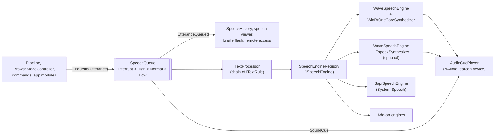
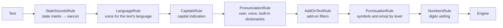
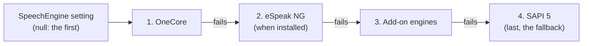

# Speech and audio

Everything Vox says goes through one `SpeechQueue`, then a chain of text rules, then
`SpeechEngineRegistry`, which forwards to the speech engine in use. Sounds (earcons) and
OneCore and eSpeak speech share one audio output.

## From utterance to sound

In words: producers put utterances on the speech queue. Each queued utterance is reported to
the speech history, speech viewer, braille display and remote access. When the queue speaks
one, its text goes through the text processor's rules and then to the engine registry, which
forwards it to OneCore, eSpeak NG, SAPI or an add-on's engine. OneCore and eSpeak produce
audio that is played through the same player as the earcons; a rule can also ask for a sound
to be played before the text.

## The queue

`SpeechQueue` is a `Channel<Utterance>` with its own reader.

| Behaviour | Detail |
| --- | --- |
| Priorities | `Interrupt > High > Normal > Low`. The highest waiting priority is spoken first. |
| Epochs | Enqueuing an `Interrupt` utterance, or calling `CancelAll`, starts a new epoch: the utterance being spoken is cancelled at once and everything queued earlier is dropped. |
| Joining | `Normal` utterances that arrive within 50 ms of each other are spoken as one. |
| Waiting | `EnqueueAndWaitAsync` completes when the utterance has been spoken. Say All uses it to read line after line. |
| Muting | `IsMuted` drops everything. Sleep mode and Pause speech use it. |
| Speech on demand | With the `SpeechOnDemand` setting (Insert+Alt+S, `SpeechOnDemandCommands`; profiles can set it), `SpeechOnDemand.Drops` drops every utterance not marked `OnDemand`, i.e. not the answer to a reporting command (`CommandCatalog.IsOnDemandReport`). |

Which priority to use:

| Priority | For |
| --- | --- |
| `Interrupt` | User navigation and focus changes: the user wants the new thing now. |
| `High` | User mode toggles and other direct answers that shouldn't cut off speech. |
| `Normal` | Most announcements, load announcements, overlays. |
| `Low` | Polite live regions and background information. |

## Text rules

Just before the engine call, each utterance's text goes through `TextProcessor`, an ordered
chain of `ITextRule`s registered in `ServiceRegistration`. History and the utterance events keep
the original text. A rule that throws is skipped. A rule can also change the utterance itself
through `ITextRule.ApplyTo`: a pitch offset, or a sound cue played first.

In words, in order: state marks become sounds (and must not reach any other rule); text in
another language gets a voice for that language; capitals are indicated; pronunciation
dictionaries replace words (user, then the voice's, then the built-in one); add-on filters
run; symbols and emoji are named according to the punctuation level, in the text's language;
finally numbers are read according to the digits setting.

- The symbol tables (`symbols-en.json` and CLDR `emoji-en.json`) are generated by
  `tools/cldr/generate_symbols.py` and embedded in `Vox.Core`. Other languages' symbol names
  come from `symbols-<lang>.json`.
- `LanguageRule` reads the language from page text (UIA Culture captured into
  `VBufferNode.Language`); the `LanguageVoices` setting overrides the voice it picks.
- Dictionaries are reloaded when their files change. None are read in secure mode.

## Engines

`SpeechEngineRegistry` is the `ISpeechEngine` everything speaks through.

In words: the registry holds the engines in order of preference: OneCore, eSpeak NG when it is
installed, any add-on engines, and SAPI 5 last as the fallback. It starts the engine the
`SpeechEngine` setting names, or the first one when there is no setting. An engine that fails
to start, or fails while speaking, is replaced by the next one in the list that starts.

- Switching happens at run time. Rate, pitch, volume and voice are re-applied to the new
  engine.
- `WaveSpeechEngine` wraps an `IWaveSynthesizer` (OneCore or eSpeak NG) and plays its audio
  through `AudioCuePlayer` (`IAudioStreamPlayer`), so speech and earcons use the same device.
  See [eSpeak NG](../espeak.md).
- `SapiSpeechEngine` uses `System.Speech`.
- Add-ons can add engines (`SpeechEngineRegistry.Add`).
- The engine is initialised at startup, so the first utterance isn't delayed.

## Earcons

`AudioCuePlayer` (NAudio) plays the earcon scheme named by `EarconScheme`
(`assets/sounds/<scheme>/manifest.json` plus WAV files; missing sounds fall back to `default`).
Earcons mark mode changes, boundaries, wrapping, states (with `StatesAsSounds`) and progress.
`AudioDucking` lowers other applications while Vox speaks, when turned on.
