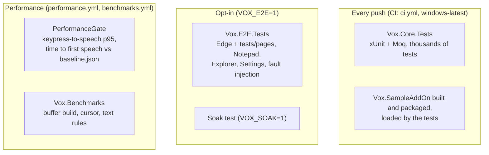

# Testing

Vox's logic sits behind interfaces, so most of it is tested without a screen, voice, braille
display or browser. `dotnet build && dotnet test` must both pass before every commit.



In words: on every push CI builds the solution on Windows, runs the unit tests and builds the
sample add-on, which the tests load. End-to-end tests run Vox against real applications only
when `VOX_E2E=1` is set, and the soak test also needs `VOX_SOAK=1`. Separate workflows run the
performance gate and the benchmarks.

## Unit tests

- `tests/Vox.Core.Tests` mirrors the folders of `src/Vox.Core`. A test for
  `src/Vox.Core/Buffer/VBufferCursor.cs` is in `tests/Vox.Core.Tests/Buffer/`.
- Tests need Windows (WinForms and the Windows TFM). On Linux,
  `dotnet build -p:EnableWindowsTargeting=true` builds but the tests can't run.
- Tests that need live UIA COM are marked `[Fact(Skip = ...)]`.

```bash
dotnet test
dotnet test --filter "FullyQualifiedName~Vox.Core.Tests.Buffer.VBufferCursorTests"
dotnet test --filter "FullyQualifiedName~VBufferCursorTests.NextChar_AdvancesOffsetByOne"
```

### Seams

| Interface or helper | Stands in for |
| --- | --- |
| `ISpeechEngine` → `RecordingSpeechEngine` | The speech engine; records what would be said. |
| `IKeyboardHook` | The low-level hook. |
| `IEventSink` | The pipeline, for producers. |
| `IAudioCuePlayer` | Earcons. |
| `IVBufferElement` | UIA elements, for building buffers from hand-made trees. |
| `ITextDocument`, `IFocusedTextSource` | Edit fields and their caret. |
| `INavigatorObject` → `MockNavigatorObject` | UIA elements for object navigation. |
| `IForegroundWindow` | The foreground window. |
| `IBrailleDisplay` → `FakeBrailleDisplay`, `FakeBrailleTranslator` | Braille hardware and liblouis. |
| `IOfficeObjectModel` → `FakeOfficeObjectModel` | Office's object model. |
| `FakeRegistry` | The registry, for machine defaults and Group Policy. |
| `TimeProvider` → `ManualTimeProvider`, injected clocks | Time. |
| `TestOptionsMonitor` | Settings. |
| `CapturingLogger` | Logs, for checking nothing sensitive is logged. |
| `FaultyElement` | A UIA element that throws or hangs. |
| `PseudoLocalizer` | Translations, to prove no English is hard-coded. |

These live in `tests/Vox.Core.Tests/TestSupport/`.

### Tests that guard rules

Some tests exist to keep project-wide rules true:

- every `NavigationCommand` has a `CommandCatalog` entry;
- every string name the code asks for exists in `Strings.resx` (`StringResourceTests`), and the
  pseudo-locale test proves `AnnouncementBuilder` has no hard-coded English;
- typed text and field values are never logged (`SensitiveTextLoggingTests`);
- the buffer builder stays within 500 ms for 10,000 nodes (`BufferBuildBudgetTests`);
- the test-page corpus and its manifest stay in step (`TestPageCorpusTests`).

## End-to-end tests

`tests/Vox.E2E.Tests` runs Vox in-process with a recording speech engine and presses keys with
`SendInput`, against Edge with the pages in `tests/pages/`, Notepad, Explorer and Settings, and
against `tests/Vox.FaultTestApp` for fault injection. Run as a program it is an interactive
runner. See [end-to-end tests](../e2e.md).

## Performance

`Performance/PerformanceTests` records keypress-to-speech p95 and time to first speech for each
page, and `PerformanceGate` holds them to `Performance/baseline.json`. `Vox.Benchmarks` uses
BenchmarkDotNet for the buffer builder, cursor and text rules. See [performance](../performance.md)
and [benchmarks](../benchmarks.md).
