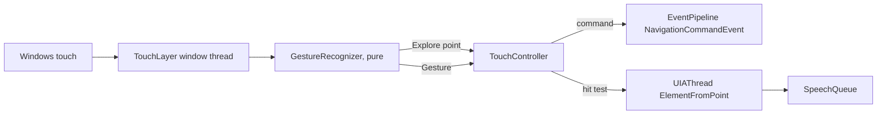

# Touch input (design)

This page is the design for touch support (Milestone G, `specs/community-requests.md`). Nothing
here is built yet; the implementation task follows it. A touch-screen user explores the screen
by finger and Vox speaks what is under it, as the keyboard and the mouse already can.

## Goals and limits

- Explore by finger: touching the screen says the object under the finger, and nothing is
  activated by touching alone.
- Double-tap activates the last object explored; flicks move to the next or previous object,
  or, in browse mode, to the next or previous heading, link or form field; a two-finger tap
  stops speech.
- The gestures are bound by a touch keymap in the keymap format, so they appear in the gestures
  dialog, command search and the keyboard reference like any key.
- Never on secure screens or when `RunPolicy` forbids it. Touch input is not logged beyond
  gesture names.

## Where touch input comes from

Windows sends touch to the app under the finger, so a screen reader that wants every touch
must take it before the app does. Three sources were considered:

| Source | Sees all touch | Can swallow it | Needs |
|---|---|---|---|
| `WM_POINTER` on a window of Vox's | no, only its own window | n/a | nothing |
| A transparent full-screen touch layer window | yes, while it is up | yes, the layer is what is touched | UI access, to sit above elevated windows |
| `WH_MOUSE_LL` | only touch promoted to mouse | partly | nothing |

The design uses the **touch layer**: a layered, topmost, per-monitor-DPI-aware window on a
thread of its own (like `WindowsMagnifier`'s), covering the virtual screen. It is hit-test
transparent for pen and mouse (`WM_NCHITTEST` returns `HTTRANSPARENT`) and receives touch
through `WM_POINTER*` messages (`GetPointerTouchInfo`). When touch is off it does not exist.
Signed builds with UI access (`docs/signing.md`) stay topmost over elevated windows; an unsigned
build covers ordinary windows only, and Vox says so once when touch is turned on.

While the layer is up a touch is not delivered to the app. A gesture Vox does not claim is
passed on by re-injecting it with `InjectTouchInput`; the first version passes nothing on and
the guide says so.

In words: the layer window turns pointer messages into `TouchPoint`s and gives them to a pure
recogniser. The recogniser emits either an explore point or a named gesture. Gestures become
`NavigationCommandEvent`s through the same path as keys; explore points go to the UIA thread for
a hit test and are spoken.

## Seams

Everything testable sits behind `ITouchSource` (a stream of `TouchPoint`s plus `Start`/`Stop`),
so tests drive a `FakeTouchSource` with scripted fingers and an injected `TimeProvider`:

- `TouchPoint(Id, X, Y, Phase, Timestamp)`, `Phase` being down / move / up / cancel.
- `GestureRecognizer` (pure): consumes points and emits `TouchGesture`s: Tap, DoubleTap,
  TripleTap, flicks in four directions, each with a finger count of one to three, and
  `Explore` for a finger that stays down or moves slowly.
- `TouchController` (thread-safe, one lock, injectable `TimeProvider`): acts on gestures.
  `WindowsTouchSource` is the only code that touches Win32.

## Recognition rules

Thresholds are in millimetres and milliseconds, converted with the monitor's DPI so they hold on
any screen. They live in one `TouchThresholds` record that tests can replace.

- **Explore**: one finger down and moving at under 150 mm/s, or held for 120 ms. The point is
  reported at most every 60 ms, and only after the finger has moved 2 mm.
- **Flick**: one finger that travels at least 12 mm at over 150 mm/s and lifts. The direction is
  the dominant axis.
- **Tap**: down and up within 250 ms and under 3 mm of movement. A **double-tap** is two taps
  within 350 ms and 8 mm of each other. A single tap does nothing, so nothing waits for a second
  one; a triple-tap is recognised only when something is bound to it.
- **Two- and three-finger gestures**: all fingers down within 100 ms of each other and moving as
  one. A change in finger count in the middle of a gesture cancels it.
- A cancel (`WM_POINTERCAPTURECHANGED`) ends everything in progress without a gesture.

## Exploring: what is under the finger

An explore point goes to the UIA thread as one `ElementFromPoint` lookup, as `MouseTracker` does
(none in flight twice, newest wins). The element is announced like focus by `AnnouncementBuilder`,
but only when it differs from the last one explored. It becomes the **navigator object**, so
flicks and the review commands continue from it, and double-tap activates it through
`ElementActivation` (pattern, then a click at its clickable point, then focus). In a web document
the element is also looked up in the buffer so the browse cursor moves to it, which lets a flick
by heading start from where the finger is.

Explore speech is `Interrupt` priority, like mouse tracking. Lifting the finger does not stop
speech.

## Gestures and the touch keymap

Gestures are `NavigationCommand`s. A command that exists for the keyboard is reused (next
object, previous object, activate, stop speech); only the few that do not exist are added at the
end of `NavigationCommand`, each with a `CommandCatalog` entry. The mapping is a JSON keymap,
`assets/config/touch-keymap.json`, in the keymap format with a gesture in place of a key
(`"gesture": "FlickRight"`, `"fingers": 1`), layered like the other keymaps: the user's
`%APPDATA%/Vox/touch-keymap.json` on top, `"command": "None"` unbinds. Defaults:

| Gesture | Outside browse mode | Browse mode |
|---|---|---|
| Explore | speak object under finger | same, and move the browse cursor there |
| Double-tap | activate | activate the element at the cursor |
| Flick right / left | next / previous object | next / previous item of the rotor |
| Flick down / up | next / previous object of the same type | next / previous line |
| Two-finger tap | stop speech | stop speech |
| Two-finger double-tap | pause / resume speech | pause / resume speech |
| Three-finger flick right / left | not used | next / previous rotor setting |
| Three-finger tap | Vox menu | Vox menu |
| Two-finger flick down | Say All | Say All |

The **rotor** is the rotor-like mode choice from the spec: a short list (headings, links, form
fields, landmarks, lines) chosen by three-finger flicks and spoken when it changes. Flicks right
and left then run the matching quick navigation command (`QuickNavHandler`). The choice is kept
for the session, not saved.

Browse and Focus bindings follow the keys' rule: they apply only while a web document has focus;
elsewhere only "Any" bindings do (`KeyMap.TryResolveOutsideDocument`). Input help (Insert+1) also
reports touch: it says the gesture and the command's name and description, and the gesture is
swallowed.

## The magnifier

- A full-screen magnifier changes what is seen, so a touch point is converted from the
  magnified view back to the screen with `MagnifierViewport` (view point ÷ zoom + source origin)
  before the hit test. `TouchController` asks `IMagnifier` for the current transform; with the
  magnifier off it is the identity.
- An explored element is reported to `MagnifierFeed` as a position (`MagnifierFollowTouch`, on by
  default). The view is not moved while a finger is down, so the picture does not slide under it;
  it follows on lift.
- The screen curtain does not affect touch: it is a colour effect, not a window.

## Settings and policy

New settings: `TouchEnabled` (default off; the wizard offers it when
`GetSystemMetrics(SM_DIGITIZER)` reports a touch screen), `MagnifierFollowTouch` and
`TouchRotorItems`. `RunPolicy.AllowTouch` is false on secure screens. Group Policy can lock the
settings like any other. The Vox menu gets a Touch toggle.

## Tests

- `GestureRecognizerTests` over scripted points and a fake clock: each gesture, thresholds at the
  edges, finger-count changes, cancel.
- `TouchKeyMapTests`: load, user overlay, unbind, conflicts, the mode rule.
- `TouchControllerTests` with `FakeTouchSource`, `RecordingSpeechEngine` and a fake hit-test
  source: exploring says the element once, flicks run the right commands in each mode, the rotor
  cycles, double-tap activates, two-finger tap stops speech, nothing happens when disabled or on
  secure screens, the magnifier transform is applied.
- The keyboard reference gains a touch table generated from `touch-keymap.json`.
