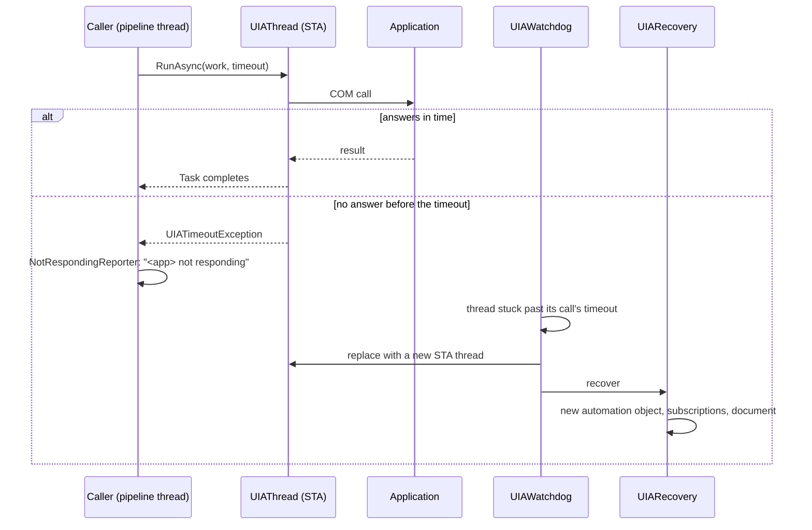
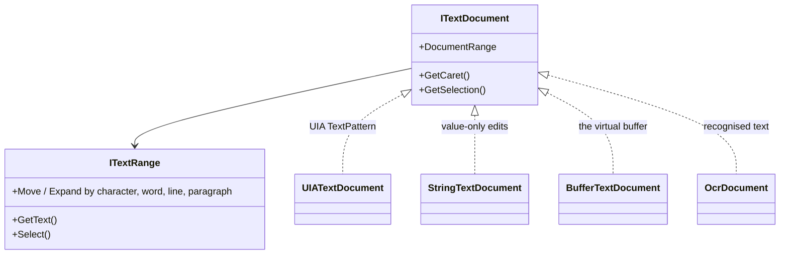
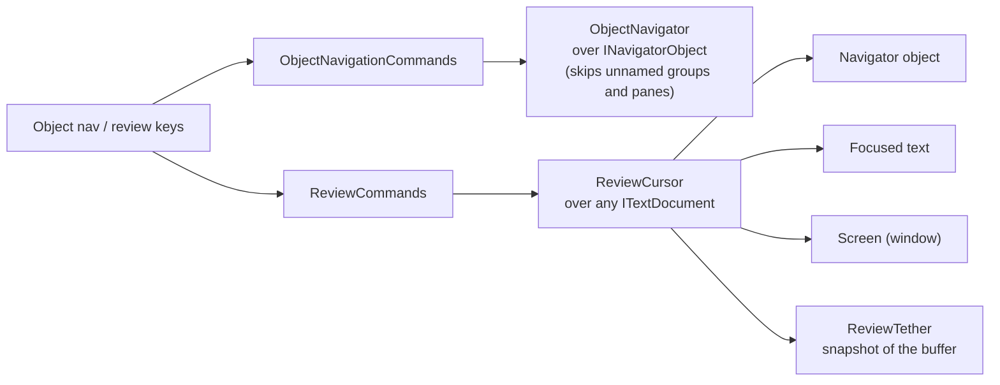

# UI Automation

Vox reads Windows through UI Automation (UIA), using the COM API (`IUIAutomation`). All UIA
interop lives in `src/Vox.Core/Accessibility/`. Applications can be slow or hang, and a hung
application must never hang Vox, so every UIA call runs on one dedicated thread with a timeout.

## The UIA thread

`UIAThread` owns a dedicated STA thread. Every COM call goes through `UIAThread.RunAsync(...)`,
which queues the work and returns a `Task` completed through a `TaskCompletionSource`.

In words: a caller hands work to the UIA thread with a timeout. If the application answers,
the task completes. If not, the caller gets a `UIATimeoutException` and Vox says the
application is not responding. If the thread stays stuck past the call's timeout, the watchdog
replaces it with a new thread and `UIARecovery` re-creates the automation object, the event
subscriptions and the current document on it.

| Timeout | Value | Used for |
| --- | --- | --- |
| `DefaultTimeout` | 2 s | Ordinary calls. |
| `SetupTimeout` | 10 s | Creating the automation object, subscribing. |
| `DocumentTimeout` | capture timeout + 5 s | Capturing a whole web document. |

Rules:

- Never share a UIA object across threads. Take what you need on the UIA thread (or capture a
  COM-free snapshot) and post the result.
- UIA event callbacks in `UIAEventSubscriber` only post to the pipeline and return.
- No command handler awaits the UIA thread, so Stop speech and Quit always work.
- Batch property reads with an `IUIAutomationCacheRequest` instead of one call per property.

## Events Vox listens to

`UIAEventSubscriber` subscribes to focus changes, property changes, live regions, notifications,
async content loads, menus (opened, closed, menu mode) and tooltips, and turns them into
pipeline events. Structure changes inside a web page are handled by `BrowseDocumentTracker`
(see [the virtual buffer](virtual-buffer.md#live-updates)).

On each focus change, `FollowFocusForTextAsync` also subscribes to caret, text, property and
selection events on the focused element when it has text. That feeds:

- `FocusedTextMonitor` and `TextCaretTracker`: caret moves, selection changes, deletions and
  spelling errors in edit fields and editors;
- `TerminalMonitor`: new output in a console or terminal.

`ForegroundWindowMonitor` posts `ForegroundWindowChangedEvent`; `AppModuleManager` uses it and
focus changes to pick the active [app module](extensibility.md#app-modules).

## Text model

`src/Vox.Core/Text` models text the way UIA's TextPattern does, so the same code reads an edit
field, a review of the screen and the virtual buffer.

In words: `ITextDocument` gives ranges (`ITextRange`) that move and expand by character, word,
line or paragraph. It is implemented over a UIA TextPattern, over a plain string for fields
that only have a value, over the virtual buffer, and over text recognition results.

## Object navigation and review

These let the user explore anything on screen, not just what has focus.

In words: object navigation commands move an `ObjectNavigator` through the UIA tree, skipping
unnamed groups and panes in simple review. Review commands move a `ReviewCursor` over a text
document: the navigator object's text, the focused text, the whole window, or (while browsing)
a snapshot of the buffer.

Both run on the UIA thread and speak from inside the UIA work item, so quick presses are said
in order. The tether snapshot is taken on the pipeline thread.

Related pieces:

- `MouseTracker` polls the pointer, with at most one `ElementFromPoint` lookup per 100 ms and
  never two at once, and speaks what is under it when it changes.
- `MouseCommands` moves the pointer to the navigator object and clicks or locks the button
  through `IMouseInput`.
- `ElementActivation` activates an element: its pattern (Invoke, Toggle, SelectionItem,
  ExpandCollapse, a default action), else a click at its clickable point, else focus.
