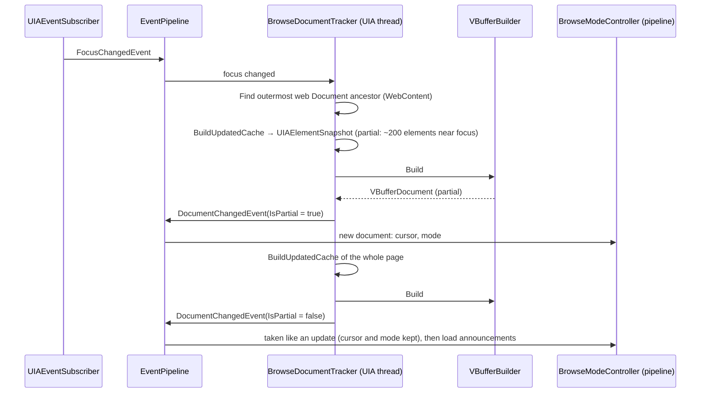
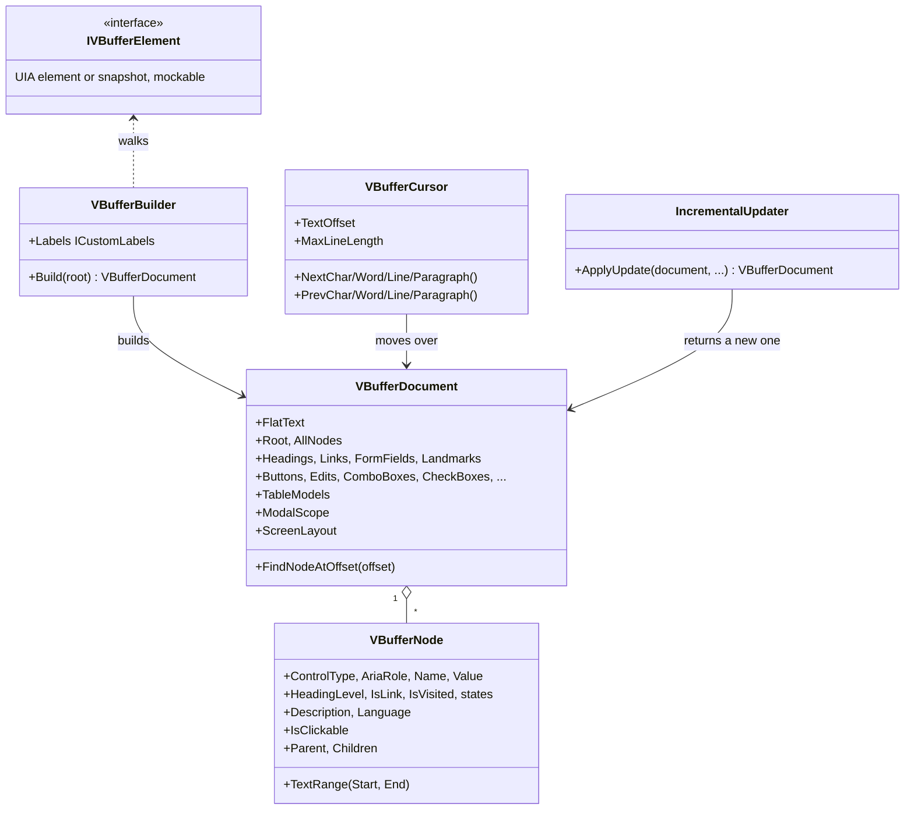
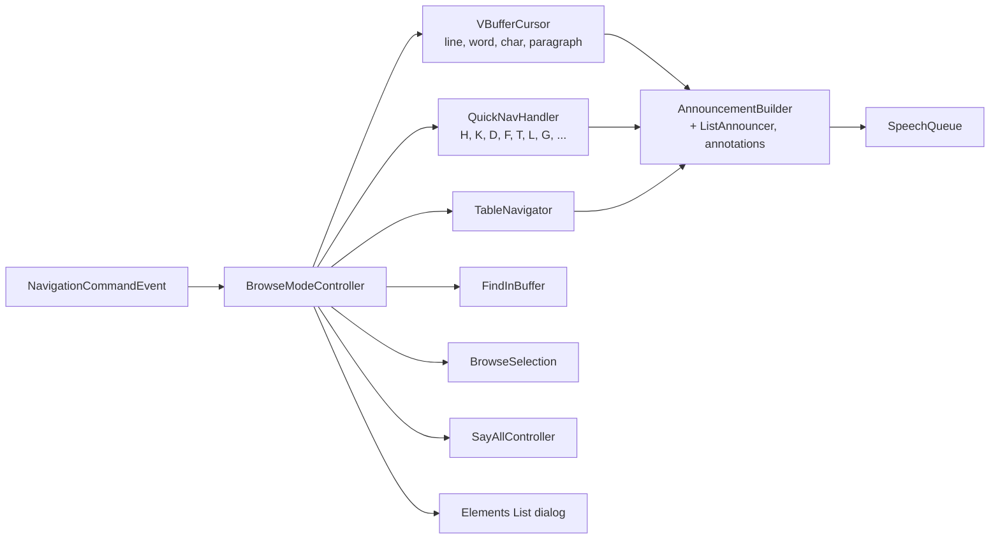
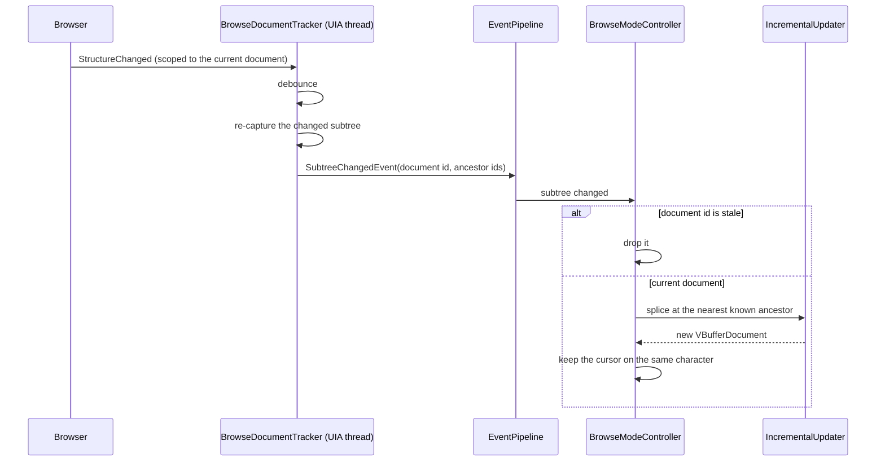

# Web pages and the virtual buffer

In a browser, Vox doesn't read the page through UIA one element at a time. It captures the
page once into a COM-free snapshot, builds a **virtual buffer** (one flat string of the page's
text plus indexes of its elements), and moves a cursor through that string. Every browse-mode
key works on the buffer, so it answers instantly and never waits for the browser.

## Capturing a page

In words: on a focus change the tracker, on the UIA thread, finds the outermost web document
around the focused element. It captures the part of the page near the focus first with one
cached UIA call, builds a partial buffer and posts it, so speech can start at once. It then
captures the whole page and posts that; the controller takes it like an update, keeping the
cursor and mode, and only then makes the load announcements.

- `WebContent` decides what is a web document: the Chrome or Gecko framework, or anything but a
  Win32 window inside a Firefox `Mozilla*` window. Electron and WebView2 apps report the Chrome
  framework, so they work like Chrome. See [Firefox](../firefox.md) for its limits.
- The capture is one `BuildUpdatedCache` call into a `UIAElementSnapshot` tree, which has no
  COM objects in it, so it can be handed to another thread.
- A failed capture isn't recorded as loaded and is retried once.
- `BufferBuildBudgetTests` holds the builder to 500 ms for 10,000 nodes.

## The buffer

In words: the builder walks a tree of `IVBufferElement`s (a UIA element or a snapshot of one,
and a mock in tests) into a `VBufferDocument`. The document holds the flat text, the nodes with
their offsets and properties, prebuilt indexes for each kind of element, a `TableModel` per
table, the modal dialog's span and the layout setting. The cursor moves over the text, and the
incremental updater returns a new document for each change rather than changing the old one.

How the text is built:

- A node emits its name only if no descendant emitted text, which avoids Chromium's duplicate
  link and heading text.
- With `ScreenLayout` on (the default), inline runs (links, inline text) are joined onto one
  line. Off, every element gets its own line.
- Lines longer than `MaxLineLength` (default 100) are split at a word boundary by the cursor.
- Form fields read as label plus value, never a password's value, and are capped at 1,000
  characters in the buffer.
- ARIA states are read the way Core-AAM maps them to UIA (`AriaStates`): invalid, current, sort,
  pressed, role description, key shortcuts, details.
- `PageElements` classifies nodes for the quick-navigation indexes; `FormControls` and
  `ControlTypeNames` are shared with the focus announcement code.
- `TableModel` places cells using row and column spans from UIA GridItem, finds header cells and
  tells layout tables from data tables.

## Browse mode

In words: `BrowseModeController` takes each browse command and hands it to the cursor, quick
navigation, table navigation, find, selection, Say All or the Elements List. What the user lands
on is turned into speech by `AnnouncementBuilder`, with list boundaries and annotations
crossed on the way, and put on the speech queue.

- Moving the cursor (except by character) says list boundaries crossed (`ListAnnouncer`).
  Annotations, figures, clickable elements and abbreviations are said on entry and exit.
- While a modal dialog is open, `VBufferDocument.ModalScope` keeps quick navigation, cursor
  moves, Say All and the cursor after an update inside it.
- `OverlayDetector` finds an open modal dialog or cookie banner and its reject or close button;
  it is announced once, and only Insert+Shift+D presses it.
- The controller remembers the reading position of recently visited documents.
- Activating an element goes back to the UIA thread through
  `BrowseDocumentTracker.ActivateAsync` and `ElementActivation`.
- Vox's dialogs (Elements List, find) run on their own STA thread and report back with
  `ElementsListClosedEvent` and `FindPromptClosedEvent`.

## Live updates

Pages change while they are read. Vox keeps up without rebuilding everything.

In words: structure changes in the current document are debounced and the changed part is
re-captured. The update is tagged with the document's id and the element's ancestors. The
controller drops updates for an old document; otherwise the updater splices the new subtree in
at the nearest ancestor it knows and returns a new document, and the cursor stays on the same
character.

## Other things built on the buffer

- **Selection and copy**: `BrowseSelection` (Shift+arrows, Ctrl+A, the Insert+F9/F10 mark),
  copied through `IClipboard`.
- **Math**: `MathMarkup` rebuilds MathML from the buffer for MathCAT; `MathExplorer` turns the
  arrows into MathCAT navigation.
- **PDFs** in Edge and Chrome are browsed as their tag tree; `PdfDocuments` says when one is
  untagged or has no text, and offers text recognition.
- **Custom labels** name an element by the user's label (see
  [extensibility](extensibility.md#custom-labels)).
- **Per-site settings** are applied through `BrowseModeController.CurrentSite` (see
  [configuration](configuration.md)).
